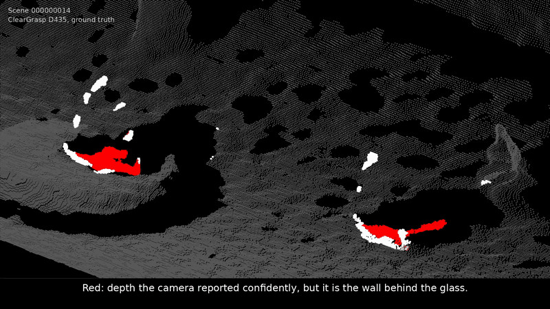

# limit_case_ros2

Detect silent depth failures on transparent objects, in ROS 2.

[](https://github.com/limit-case/ros2/actions/workflows/ci.yml)
[](https://docs.ros.org/)
[](LICENSE)


<sub>Raw RealSense D435 depth on a ClearGrasp test scene, coloured by ground truth.
Red: confidently wrong (it is the table behind the glass). Green: where the glass really is.</sub>

On glass, depth cameras don't just go blank. They often return a confident depth of whatever is behind it.
`limit_case_ros2` sits between your depth driver and Nav2 or MoveIt, flags those pixels, and
publishes the suspected glass as an obstacle cloud.

v0.1 is a depth-only baseline: it removes 14.6% of the wrong glass pixels on ClearGrasp D435
at 7.4 ms per 1280x720 frame (core filter), and [Results](#results) explains why depth alone can't do much more.
Research-grade, not safety certified.

## Results

| ClearGrasp set (5% tolerance) | Wrong among returned (raw -> after) | Wrong pixels removed | Correct pixels lost | Outside-mask flagged |
|---|---|---|---|---|
| D435 test (23 scenes), run once | 23.9% -> 22.6% | 14.6% | 7.9% | 8.7% |
| D435 val (173 scenes), the tuning set | 51.3% -> 48.6% | 14.6% | 4.7% | 6.0% |
| D415 test (90 scenes), run once | 36.9% -> 35.2% | 11.4% | 4.5% | 8.7% |

Most wrong pixels survive. Sources, definitions, latency details and the reason depth alone falls short:
[`docs/results.md`](docs/results.md).

## Quick start

Build (ROS 2 Jazzy or Humble already installed and sourced, with `colcon` and `rosdep`):

```bash
mkdir -p ~/ros2_ws/src && cd ~/ros2_ws/src
git clone https://github.com/limit-case/ros2.git limit_case_ros2
cd ~/ros2_ws
sudo apt-get update && rosdep update
rosdep install --from-paths src -y --ignore-src
colcon build --packages-select limit_case_ros2
source install/setup.bash
```

Get the demo bag (no hardware needed; 29 MB download from the v0.1.0 release, SHA256-checked, unpacked to
`./demo_bag`):

```bash
src/limit_case_ros2/scripts/fetch_demo_bag.sh
```

See the failure itself, the ground-truth error view (the picture at the top):

```bash
ros2 launch limit_case_ros2 demo_bag.launch.py bag:=demo_bag gt:=true
```

This colours the **raw** cloud with ClearGrasp ground truth: red = glass pixels that are wrong (more than 5% off),
white = glass pixels that are correct, dim grey = not glass, missing pixels not drawn. Orbit to the side: the red
points sit behind the glass. It needs `gt_sidecar.npz` in the bag folder (shipped with the release bag, or made with
`scripts/gt_error_cloud.py prepare`; see [`docs/demo_scenes.md`](docs/demo_scenes.md)).

Run the filter on the same bag:

```bash
ros2 launch limit_case_ros2 demo_bag.launch.py bag:=demo_bag
```

RViz shows the raw cloud in grey, the filtered cloud in white and the suspected glass surface in orange. Not every
orange point is glass, see [Limitations](#limitations). Add `rviz:=false` on a machine without a display; the topics
below are still published.

On a live camera:

```bash
ros2 launch limit_case_ros2 limit_case_filter.launch.py sensor_profile:=realsense_d435
```

`realsense_d435` is the profile the results above were measured with. `default` keeps the untuned defaults.

No ROS install on a Mac, or no display? `docker/Dockerfile.demo` runs RViz in a container you view in the browser
(noVNC); see [`docs/recording.md`](docs/recording.md). Develop on any OS with `docker/Dockerfile` or the devcontainer.

> **Not a safety certification.** This is research-grade software. Do not rely on it as the only
> protection against collisions. It has no safety certification of any kind.

## How it works

Glass is usually surrounded by pixels that read correctly (rim, frame, label, table edge, holes). Its interior
reads **farther** than that boundary, so in a depth image it looks like a **basin**. Treat depth as terrain
(`elevation = -depth`) and fill depressions with **Priority-Flood** (Barnes, Lehman, Mulla 2014, O(n log n)).

1. Downsample (min of valid pixels: nearest surface wins). Invalid pixels are impassable walls (`realsense_d435`: plus a
   check that part of each region's boundary is valid pixels nearer than the region).
2. Priority-Flood fill. The fill level is the depth of the enclosing boundary, our estimate of the glass surface.
3. Basin depth = `depth - fill depth`. Candidates must pass an absolute and a relative threshold.
4. Connected components, drop small and border-touching regions, score each region
   (basin depth, adjacency to invalid pixels, optional specular highlights), flag at `confidence_threshold`.
5. Outputs: filtered depth, mask, and a point cloud of the fill surface back-projected with the intrinsics.

Dropping pixels is not enough: Nav2 and MoveIt discard invalid pixels, so glass would become *unknown* space,
not an obstacle. The `suspected_obstacles` cloud is what makes the robot avoid it.

Why this gets only part of the way (numbers and the ablation in [`docs/results.md`](docs/results.md)):

- Almost every wrong pixel on glass reads **too far** (99.8% to 100.0% across the three sets). That is the one fact
  v0.1 uses.
- But 32.2% to 62.5% of the pixels on transparent objects come back **missing**, so the glass is mostly bordered by
  holes, not by a ring of valid nearer pixels, and no basin forms in the depth image.

## Topics

| Topic | Type | Notes |
|---|---|---|
| `depth/image` (sub) | `sensor_msgs/Image` | `16UC1` (mm) or `32FC1` (m). Launch default: `/camera/aligned_depth_to_color/image_raw` |
| `depth/camera_info` (sub) | `sensor_msgs/CameraInfo` | intrinsics for the cloud |
| `color/image` (sub) | `sensor_msgs/Image` | optional, only if `use_rgb: true` (ApproximateTime, slop 0.03 s) |
| `/limit_case/depth/filtered` | `sensor_msgs/Image` | same encoding; flagged pixels 0 (`16UC1`) / NaN (`32FC1`) |
| `/limit_case/mask` | `sensor_msgs/Image` | `mono8`, 255 = suspected see-through |
| `/limit_case/suspected_obstacles` | `sensor_msgs/PointCloud2` | estimated glass surface, depth frame |
| `/diagnostics` | `diagnostic_msgs/DiagnosticArray` | flagged %, regions, latency mean/p95, input rate |

All outputs reuse the input depth header.

## Parameters

| Name | Default | Meaning |
|---|---|---|
| `sensor_profile` | `default` | name of the loaded YAML profile (logging) |
| `downsample` | 2 | run the core at 1/N resolution |
| `min_basin_depth_m` | 0.02 | pixel must read at least this much farther than the fill level |
| `min_basin_depth_rel` | 0.03 | and at least this fraction of its depth |
| `min_region_area_px` | 150 | at full resolution |
| `max_range_m` | 4.0 | ignore pixels beyond this |
| `treat_invalid_as_wall` | false | false: holes are impassable, a patch reachable only through holes is ignored. true: BFS wall option (holes take the elevation of the valid cells they border) |
| `boundary_verify` | false | flag a region only if part of its boundary is valid pixels nearer than it; cloud depth = median of those pixels |
| `min_nearer_boundary_frac` / `flag_hole_only` | 0.1 / false | `boundary_verify` tuning: required share of nearer valid boundary; flag hole-only regions in the mask without a cloud |
| `use_rgb` | false | enable the specular highlight vote (startup only) |
| `specular_v_thresh` / `specular_s_thresh` | 240 / 40 | HSV highlight thresholds |
| `confidence_threshold` | 0.5 | lower = more aggressive |
| `publish_cloud` / `cloud_stride` | true / 2 | suspected-obstacle cloud |

Offline evaluation without ROS: `filter_cli` (PNG/EXR folders in, masks out) and `scripts/eval_glassbench.py`.

## Nav2

See [`nav2/costmap_snippet.yaml`](nav2/costmap_snippet.yaml). Two observation sources:
the filtered depth cloud (`marking: true, clearing: true`) and `/limit_case/suspected_obstacles`
(`marking: true, clearing: false`). **Clearing must be off for the glass cloud**: on the next frame the glass reads
as far-away free space, so a clearing source would raytrace through the glass and erase the cells just marked.

## Limitations

- **Depth-only enclosure fails on most glass.** The filter needs glass to be enclosed by returned, nearer pixels.
  In ClearGrasp 32.2% to 62.5% of glass pixels are missing, so glass is mostly bordered by holes and no basin
  forms. That is why only 14.6% (D435 test) and 11.4% (D415 test) of the wrong pixels are removed.
- **False alarms become phantom obstacles.** On both test sets 8.7% of the returned pixels *outside* the glass mask
  are flagged (column `outside_flagged`; 6.0% on D435 val). The filter cannot tell a depth basin on glass from other
  occluded or concave areas, and the `suspected_obstacles` cloud is built from every flagged region, so these are
  published as obstacles, not just dropped from the depth image. In the demo bag many of the orange points sit on a
  dark case and a far wall, not on the glass (see `docs/demo_scenes.md`). Use this node where a spurious obstacle is
  cheaper than a collision with glass.
- **Tuned on D435 val only.** One camera, one dataset, small objects on a table. The val budget (correct lost
  <= 5%) did not hold on D435 test (7.9%). D415 and L515 profiles are untuned; nothing here was measured on doors,
  windows or walls.
- A pane that fills the whole view, or a region touching the image border, is not enclosed, so it is not flagged.
- Glass seen against a background that is *closer* than its rim (rare) is missed.
- Opaque concave objects (a bowl seen from above) can form real basins.
- Not safety certified.

## Hardware Wall of Fame

Help us map every camera. Open an issue with your sensor model and a short bag if it misses a failure.
Seeded with: RealSense D415, D435, L515.

## Roadmap

- v0.1 (this release): honest depth-only baseline.
- Next, v0.2: an RGB mask proposes the glass region and depth verifies the too-far pixels inside it. Two settings
  were each run once on D435 test / D415 test (`results/eval_rgb_proposal_*_summary.csv`):
  - The setting selected on val (5 px ring, 3 cm; 29.3% wrong removed on val) **overfit**: 8.2% / 10.3% wrong
    removed, below v0.1's 14.6% / 11.4%.
  - The untuned setting declared before the test run (v0.1 thresholds, 15 px ring): 47.4% / 20.4% wrong removed,
    7.2% / 5.4% correct lost, 0.4% / 0.4% outside-mask flagged.
  - Preferring the untuned setting is now a test-informed choice, so v0.2 fixes the selection protocol and confirms
    once on fresh data ([`docs/v0.2_protocol.md`](docs/v0.2_protocol.md)).
- Later: Gazebo glass simulation plugin, remote rosbag reports.

## Citation and licences

If you use this, please cite GlassBench:

```bibtex
@misc{glassbench2026,
  title        = {GlassBench: Silent Depth Failures on Transparent Objects},
  author       = {{Limit Case}},
  year         = {2026},
  version      = {0.1.0},
  howpublished = {\url{https://github.com/limit-case/glassbench}}
}
```

- Code: Apache-2.0, see [LICENSE](LICENSE).
- [ClearGrasp](https://github.com/Shreeyak/cleargrasp) data (all numbers above): Apache-2.0. The demo bag and its
  ground-truth sidecar are derived from ClearGrasp (Sajjan et al., ICRA 2020) and ship with the attribution in
  [NOTICE](NOTICE).
- [TransCG](https://graspnet.net/transcg): CC BY-NC-SA 4.0 (Creative Commons Attribution-NonCommercial-ShareAlike
  4.0 International), **non-commercial**. Fang, H., Fang, H.-S., Xu, S., Lu, C. "TransCG: A Large-Scale Real-World Dataset for Transparent Object Depth Completion and a Grasping Baseline." IEEE RA-L 7(3):7383-7390, 2022. doi:10.1109/LRA.2022.3183256
  It may be evaluated locally; its images, per-image data and anything rendered from them are never committed or
  shipped here.
